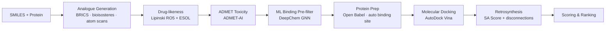
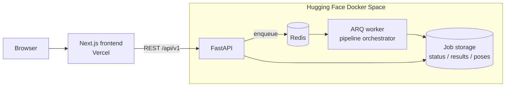

<div align="center">

# 🧬 CADD Pipeline

**An end-to-end Computer-Aided Drug Design platform: from one SMILES string to ranked, docked and synthesis-planned drug candidates.**


**[→ Try it live](https://caddpipeline.vercel.app)**

</div>

---

## Overview

CADD Pipeline takes a lead compound (as a SMILES string) and a protein target (a PDB ID or an uploaded `.pdb` file). It then runs a full virtual-screening workflow:

1. It generates hundreds to thousands of structural **analogues**.
2. It filters them for **drug-likeness** and **ADMET safety**.
3. It **docks** the survivors into the protein's binding site.
4. It estimates how hard each one is to **synthesise**.
5. It ranks everything with a transparent, configurable **composite score**.

Every tool in the stack is free and open source, and the whole backend runs on CPU, so no GPU or paid API is needed.

## Pipeline



| # | Stage | What it does | Tools |
|---|-------|--------------|-------|
| 1 | **Analogue generation** | BRICS recombination, functional-group/bioisostere swaps, halogen & substituent scans, aza-scans, side-chain edits (up to 10,000 compounds) | RDKit |
| 2 | **Drug-likeness** | Lipinski Rule of 5 with configurable MW window, ESOL solubility (logS) classification | RDKit |
| 3 | **ADMET toxicity** | Full ADMET profile with configurable per-endpoint thresholds, hard-fail endpoints (hERG, hepatotoxicity) and narrative explanations | ADMET-AI |
| 4 | **Binding pre-filter** | Fast graph-neural-network gate to keep only likely binders for docking | DeepChem |
| 5 | **Protein preparation** | Fetches structures from RCSB, strips waters/ions/buffers, auto-detects the native ligand to centre the docking box | Open Babel |
| 6 | **Molecular docking** | Docks top candidates and returns poses, affinities (kcal/mol) and downloadable `.pdbqt` / complex `.pdb` files | AutoDock Vina |
| 7 | **Retrosynthesis** | Synthetic accessibility score, estimated step count, BRICS starting materials, named reactions and conditions | RDKit |
| 8 | **Scoring** | Weighted composite score with automatic weight redistribution when stages are switched off | — |

### Scoring model

| Component | Default weight |
|-----------|---------------:|
| Docking affinity | 50 |
| ADMET safety | 25 |
| Drug-likeness | 15 |
| Synthesis ease | 10 |

If you turn a stage off, its weight is redistributed across the remaining components, so scores always sum to 100. A per-compound score breakdown is available through the API.

### Run modes

- **Full pipeline**: analogue generation, then every filter, then docking and ranking.
- **Direct score only**: score just the input molecule, with no analogue generation.
- **Toxicity report only**: a fast ADMET profile without docking.

## Architecture



The API accepts a job and returns a `job_id` straight away. A background ARQ worker then runs the long pipeline, and the frontend polls the job status to show live step-by-step progress.

## Repository structure

```
cadd-pipeline/
├── backend/                 # FastAPI + ARQ worker (deployed as a Docker HF Space)
│   ├── main.py              # API entrypoint, job submission & file downloads
│   ├── worker.py            # ARQ worker settings
│   ├── routers/             # /jobs and /health endpoints
│   ├── models/schemas.py    # Pydantic request/response models
│   ├── pipeline/            # one module per pipeline stage + orchestrator + scorer
│   ├── utils/               # PDB fetching, binding-site detection, SMILES validation
│   ├── Dockerfile
│   └── start.sh             # starts Redis, the ARQ worker and Uvicorn
├── frontend/                # Next.js 16 + React 19 + Tailwind CSS 4 UI
│   ├── app/                 # pages: input form, live status, results
│   ├── components/          # InputForm, AdvancedSettings, StatusTracker, ResultsTable, MoleculeCard
│   └── lib/api.ts           # typed API client
└── tests/                   # backend test suite
```

## API

Base path: `/api/v1`

| Method | Endpoint | Description |
|--------|----------|-------------|
| `POST` | `/jobs` | Submit a job using a PDB ID |
| `POST` | `/jobs/upload` | Submit a job with an uploaded `.pdb` file |
| `GET` | `/jobs/{job_id}/status` | Live per-step status |
| `GET` | `/jobs/{job_id}/results` | Ranked compounds with full ADMET/docking/synthesis data |
| `GET` | `/jobs/{job_id}/score-breakdown/{i}` | Score contribution of each component |
| `GET` | `/jobs/{job_id}/compounds/{i}/download/{type}` | Download `pdbqt`, `pose_pdb` or `complex_pdb` |
| `GET` | `/jobs` | List jobs |
| `DELETE` | `/jobs/{job_id}` | Delete a job |
| `GET` | `/health` | Service and dependency health |

Interactive docs are served at `/docs` (Swagger UI) when the backend is running.

<details>
<summary>Example request</summary>

```bash
curl -X POST http://localhost:7860/api/v1/jobs \
  -H "Content-Type: application/json" \
  -d '{
        "smiles": "CC(C)Cc1ccc(cc1)C(C)C(=O)O",
        "pdb_id": "1EQG",
        "num_analogues": 25,
        "max_docking_compounds": 10
      }'
```
</details>

## Getting started

### Backend (Docker, recommended)

```bash
cd backend
docker build -t cadd-backend .
docker run -p 7860:7860 cadd-backend
```

The image installs Open Babel, AutoDock Vina, Redis, RDKit, ADMET-AI and DeepChem. When the container starts, `start.sh` launches Redis, the ARQ worker and the API on port **7860**.

### Frontend

```bash
cd frontend
npm install
npm run dev
```

Then open <http://localhost:3000>. The backend URL is set in `frontend/lib/api.ts`. Point it at `http://localhost:7860` for local development.

### Tests

```bash
pip install -r backend/requirements.txt
python tests/test_backend.py
```

## Deployment

| Part | Platform | Live |
|------|----------|------|
| Frontend | Vercel (root directory: `frontend/`) | [caddpipeline.vercel.app](https://caddpipeline.vercel.app) |
| Backend | Hugging Face Docker Space (`backend/`) | [novoo5-cadd-backend.hf.space](https://novoo5-cadd-backend.hf.space) |

## Project history

This repository combines two codebases that were first developed separately: the Next.js frontend and the FastAPI backend (which was originally pushed to a Hugging Face Space). Both were merged here with their **complete original commit histories intact**. Run `git log -- backend/` or `git log -- frontend/` to see how each part developed from March 2026 onwards.

## Acknowledgements

Built on these open-source projects: [RDKit](https://www.rdkit.org/), [ADMET-AI](https://github.com/swansonk14/admet_ai), [DeepChem](https://deepchem.io/), [AutoDock Vina](https://github.com/ccsb-scripps/AutoDock-Vina), [Open Babel](https://openbabel.org/), [FastAPI](https://fastapi.tiangolo.com/), [ARQ](https://arq-docs.helpmanual.io/) and [Next.js](https://nextjs.org/).
